# Agora

A Laravel real-time chat package with conversations, groups, reactions, replies, read receipts, typing/presence, attachments, and a bundled Vue chat widget.

---

## Demo

Try the [live demo](https://agora-demo-n0w6.onrender.com/chat).

Use the built-in UI or the JSON API only.

```bash
composer require jass-sangha/agora
php artisan migrate
```

Optional: publish the package config and theme files for customization:

```bash
php artisan chat:install
```

The demo app requires a real login flow. The chat route and API are protected by `auth`/`sanctum`, so make sure your app already exposes a working login route and session-based authentication. If you do not have a login route, the package will not be able to authenticate the chat user.

---

## Screenshots

<div align="center">
  <p><strong>Full page</strong><br />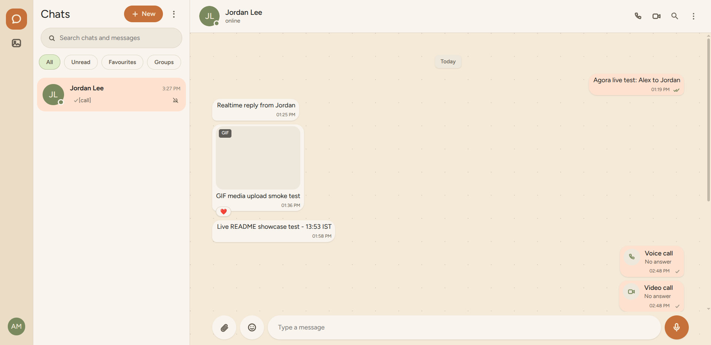</p>
  <p><strong>Chat settings</strong><br />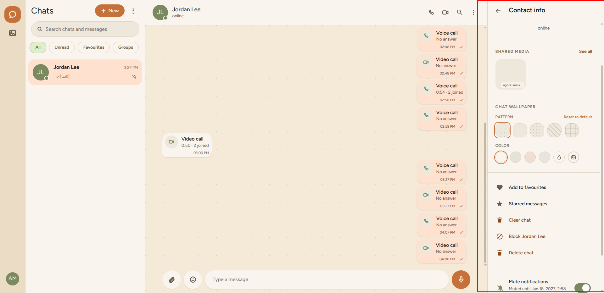</p>
  <p><strong>Sidebar options</strong><br />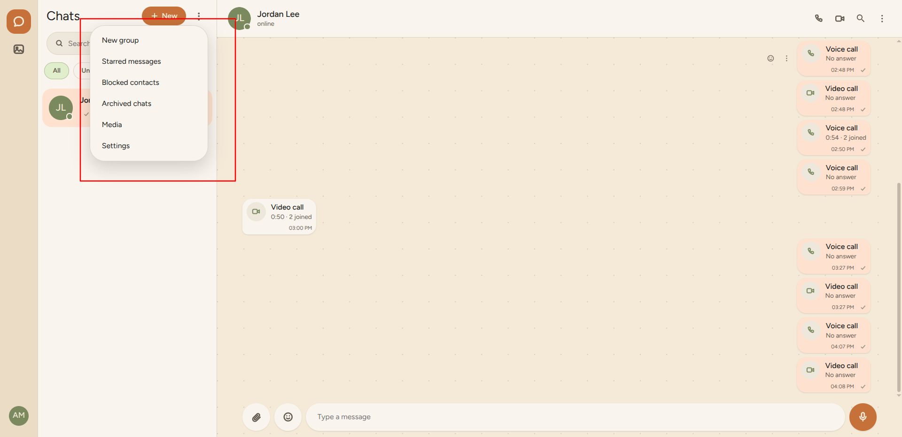</p>
  <p><strong>Sidebar profile settings</strong><br />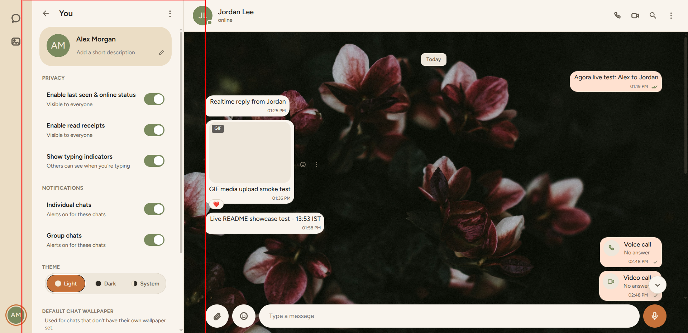</p>
  <p><strong>Chat options</strong><br />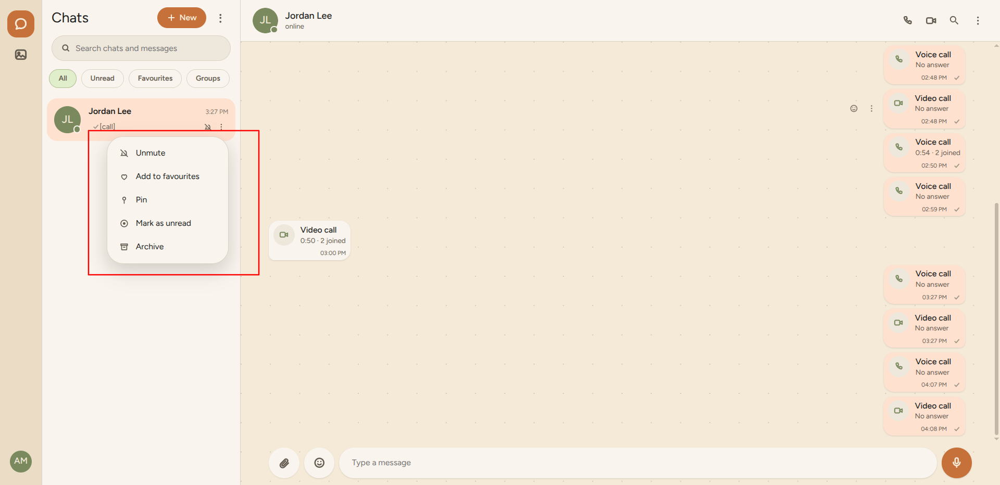</p>
  <p><strong>Attachments</strong><br />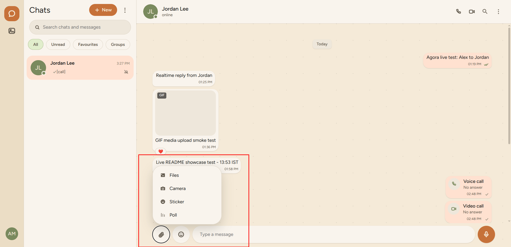</p>
  <p><strong>Reactions</strong><br />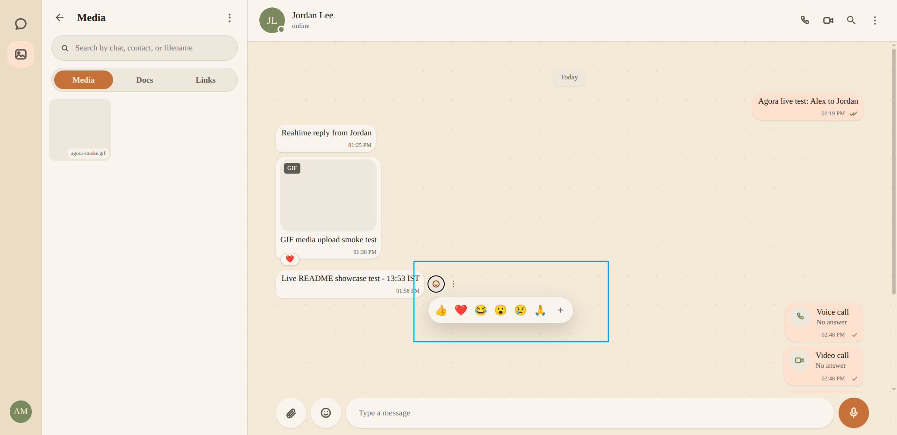</p>
  <p><strong>Call</strong><br />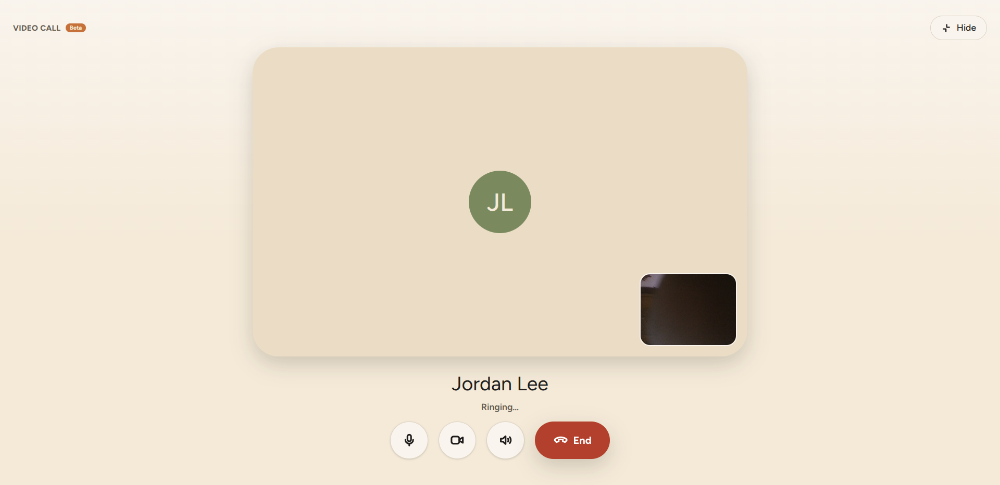</p>
  <p><strong>Embedded chat</strong><br />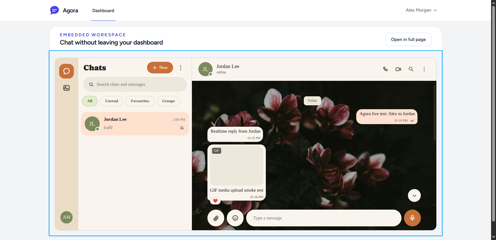</p>
  <p><strong>Dark theme</strong><br />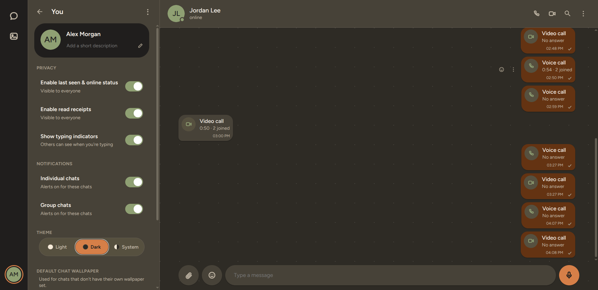</p>
  <p><strong>Custom design</strong><br />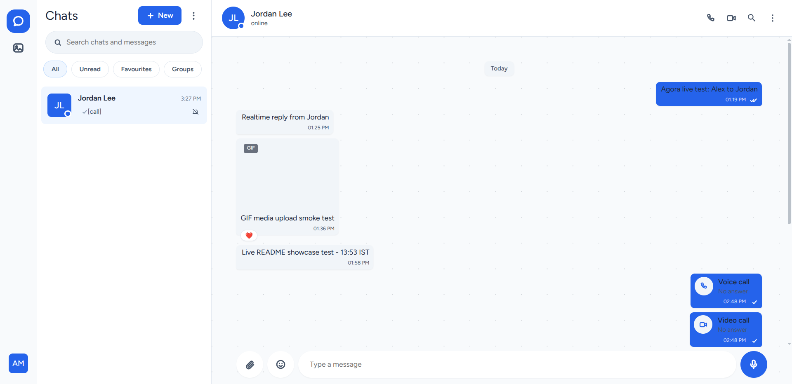</p>
  <p><strong>Custom wallpapers</strong><br />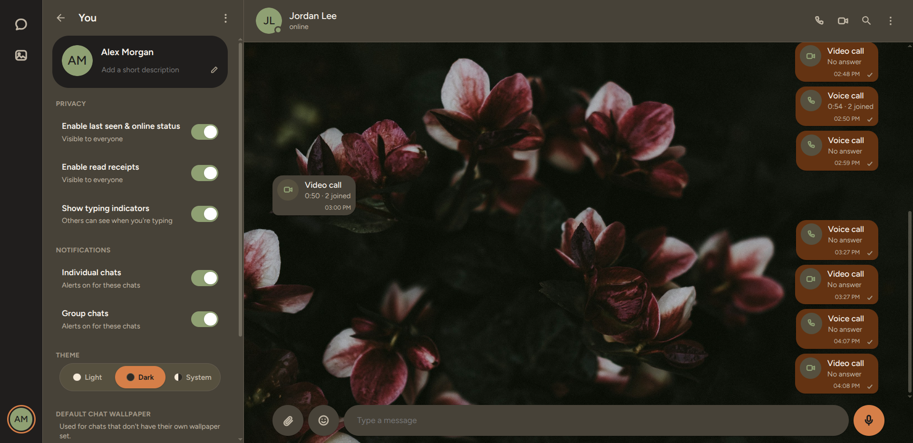</p>
</div>

---

## Setup

### Broadcasting backend

Agora supports any Laravel broadcast driver that the frontend can connect to: Reverb, Pusher, or Ably. Pick one and configure it in your app's `config/broadcasting.php` or `.env`.

#### Reverb

```bash
composer require laravel/reverb
php artisan reverb:install
php artisan reverb:start
```

```env
BROADCAST_CONNECTION=reverb
REVERB_APP_KEY=...
REVERB_APP_SECRET=...
REVERB_APP_ID=...
```

#### Pusher

If you choose Pusher, make sure its PHP server SDK is installed in the host Laravel application. Agora does not require a specific broadcast driver.

```bash
composer require pusher/pusher-php-server
```

```env
BROADCAST_CONNECTION=pusher
PUSHER_APP_ID=your-app-id
PUSHER_APP_KEY=your-app-key
PUSHER_APP_SECRET=your-app-secret
PUSHER_APP_CLUSTER=your-cluster

# Needed by a host application's Vite-built Echo frontend
VITE_PUSHER_APP_KEY="${PUSHER_APP_KEY}"
VITE_PUSHER_APP_CLUSTER="${PUSHER_APP_CLUSTER}"
```

The bundled Agora widget reads the broadcaster settings from Laravel at runtime, so these `VITE_` variables are only needed if your host app also has its own Vite-built frontend that connects to Pusher. Restart the Vite dev server or rebuild frontend assets after changing Vite environment variables.

See [Laravel's Pusher Channels setup documentation](https://laravel.com/docs/broadcasting#pusher-channels) for the complete installation and configuration steps.

#### Ably

```bash
composer require ably/ably-php
```

```env
BROADCAST_CONNECTION=ably
ABLY_KEY=your-ably-key
```

### Sync vs queue mode

Agora defaults to synchronous delivery so chat events work immediately without a queue worker.

```env
CHAT_BROADCAST_MODE=sync
```

To send broadcasts through Laravel's queue instead:

```env
CHAT_BROADCAST_MODE=queue
CHAT_BROADCAST_QUEUE=chat-broadcasts
```

When `queue` mode is enabled, a running queue worker is required. When using `sync`, you only need a valid broadcast driver (Reverb/Pusher/Ably) and a working app session.

### Voice and video calls

Calls are disabled by default. Set `CHAT_CALLS_ENABLED=true` to enable them. When disabled, voice/video call buttons are hidden in the bundled UI and both call signaling and ICE configuration endpoints return 404. Call-message history remains visible.

Calls use WebRTC and the public Google STUN server by default. STUN alone cannot connect every network. For production, configure TURN; the app issues short-lived, per-user credentials from the server, so the TURN shared secret is never sent to the browser.

Install Coturn on a publicly reachable Linux server (or use a TURN provider), point a DNS name such as `turn.example.com` at it, then configure `/etc/turnserver.conf`:

```ini
listening-port=3478
fingerprint
use-auth-secret
static-auth-secret=REPLACE_WITH_A_LONG_RANDOM_SECRET
realm=turn.example.com
min-port=49160
max-port=49200
no-loopback-peers
no-multicast-peers
```

Generate the shared secret with `openssl rand -hex 32`. Use the same value for Coturn and the Laravel server environment:

```env
CHAT_TURN_URLS=turn:turn.example.com:3478,turn:turn.example.com:3478?transport=tcp
CHAT_TURN_SHARED_SECRET=the-same-long-random-secret
CHAT_TURN_CREDENTIAL_TTL=3600
```

Restart Coturn and clear Laravel's cached config (`php artisan config:clear`, then rebuild the config cache if your deployment uses it). Open inbound UDP and TCP port `3478`, plus inbound UDP ports `49160-49200`, in both the server firewall and cloud security group. If Coturn is behind NAT, configure its `external-ip` and private `listening-ip` according to the Coturn documentation. For encrypted TURN/TLS, configure Coturn certificates and its TLS listener, then add a `turns:turn.example.com:5349` URL to `CHAT_TURN_URLS` and open TCP port `5349`.

Verify connectivity from two devices on different networks using a real call. Check browser WebRTC diagnostics (`chrome://webrtc-internals` in Chromium) and the Coturn logs; a successful API response alone does not prove relay traffic can pass. The default credential TTL is one hour and is clamped to 60 seconds–24 hours. Custom non-secret ICE server entries can still be supplied in `config/chat.php` under `calls.ice_servers`; do not put long-lived TURN credentials there because that array is sent to the browser.

Call signaling is authenticated, validates the message type and call ID, restricts peer negotiation messages to active conversation participants, and rate-limits signaling. Incoming calls time out locally and callers send a cancellation signal when they cancel or time out.

Group calls currently use a peer-to-peer mesh, so every participant uploads media separately to every other participant. TURN improves connectivity, not mesh bandwidth or CPU usage. Keep mesh rooms small; for larger production group rooms, integrate an SFU (selective forwarding unit) such as LiveKit, mediasoup, or an equivalent managed service.

For native Android/iOS WebViews, relay proximity sensor changes to the widget by dispatching a `chat:proximity` event with a boolean `near` value. The call UI displays a touch-blocking black screen while the sensor reports near, and restores the call when it reports away:

```js
window.dispatchEvent(new CustomEvent('chat:proximity', {
    detail: { near: true },
}));
```

Dispatch the same event with `{ near: false }` when the phone moves away. The bundled web UI does not have reliable access to native proximity sensors by itself; the host app must listen to the native sensor and forward its state into the WebView.

### Required auth route

The bundled chat page and API require authentication. In a Laravel app, this is normally `/login` or your app's own auth route. The package does not create a login page for you. Make sure your app has one and that the user is signed in before opening the chat UI.

### File upload limits

The package validates upload sizes in `config/chat.php`, but PHP itself also enforces server limits before Laravel sees the request.

- `media.max_sizes` defines the app-level limit
- `upload_max_filesize` and `post_max_size` must be raised in `php.ini`
- Set both for the CLI and the web SAPI (`php-fpm`, Apache, Nginx, etc.)

Example:

```ini
upload_max_filesize = 100M
post_max_size = 100M
```

If you are uploading large files, update both values and restart PHP/FPM.

---

## Common instructions

### Install the package

```bash
composer require jass-sangha/agora
php artisan migrate
```

Publish config and theme files if you want to override defaults:

```bash
php artisan vendor:publish --tag=chat-config
```

### Built-in UI

The package ships a self-contained Vue chat widget. You can use it directly or ignore it and call the REST API only.

### API routes

The default route prefix is:

```text
/api/chat
```

If you want to use the package without the built-in UI, disable the web routes:

```php
'register_ui_routes' => false,
```

### Private attachments

For signed/private attachment URLs, enable:

```php
'media' => [
    'serve_privately' => true,
    'signed_url_ttl_minutes' => 60,
],
```

### Rate limits

The package includes route-level throttling. Adjust the values in `config/chat.php` if you need different limits for message sending, uploads, search, and reactions.

---

## Notes

- The app chooses the broadcast driver from your host Laravel app config.
- Switching between Reverb, Pusher, and Ably is normally a one-line `.env` change.
- A queue is optional and only needed when `CHAT_BROADCAST_MODE=queue`.
- The package supports both cookie-based and token-based auth depending on your app setup.
